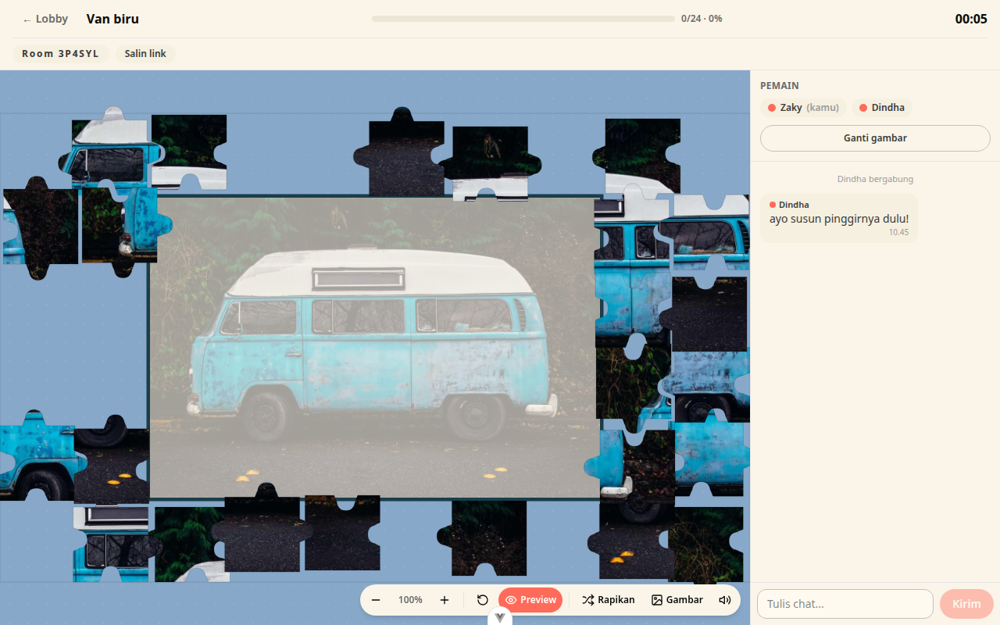

# miniGame

A tiny multiplayer mini-games platform on the web. Game 1:
real-time multiplayer jigsaw puzzle. Game 2: chess against a
Stockfish bot, with lichess-style move analysis. One board, two
people, same puzzle. Built to play together with my girlfriend,
inspired by a reel of two friends solving a jigsaw over a video call.

**Play it:** https://minigames-bxb.pages.dev/




## How to play

Pick a game on the home screen: Puzzle or Chess.

**Puzzle**

1. Pick a photo (6 presets, or upload your own) and a piece count
   (24, 48, 100, 200, or any number from 12 to 500).
2. Play solo, or create a room and share the 6-letter code (or link)
   with your partner.
3. Drag pieces around the board. Pieces that fit together stick into
   a group you can move as one.
4. Drop a piece near its spot and it snaps in. Finish the whole
   picture to win.

**Chess**

1. Pick a bot level (Easy, Medium, Hard, Extreme) and your color
   (White, Black, random), or play 2-player on one device.
2. Click a piece to see its legal moves, click a target square to move.
3. Use Hint for the engine's best move, Undo to take back.
4. After the game ends, run Analyze: Stockfish reviews every move
   (depth 18) and labels it Brilliant, Best, Excellent, Good,
   Inaccuracy, Mistake or Blunder, with accuracy per player, an
   evaluation chart, and click-to-review positions with the best line.

## Features

- **Real-time multiplayer:** live cursors with names, drag locks (a
  piece your partner is holding cannot be grabbed), in-room chat,
  system messages.
- **Server-authoritative state:** piece positions live in a Durable
  Object (SQLite), so a refresh or reconnect keeps your progress.
- **Custom photos:** upload your own, compressed in the browser first
  (long side max 1600px, target under 500 KB), stored in Workers KV.
- **Custom piece counts:** any number from 12 to 500. Counts with an
  awkward grid are rounded to the nearest count with a clean grid,
  and the final count is shown.
- **Piece grouping:** correctly adjacent pieces stick together and
  move as one group. Grouping is only checked on drop, with a tight
  tolerance, so it never gives away the answer.
- **Synced timer and progress**, sort button, snap sound (mutable),
  zoom and pan, ghost preview, full-image view.
- **No login:** nickname + cursor color, join with a code or a link.
- **Chess vs Stockfish 19 (full):** 4 bot levels (skill + depth +
  movetime), pick your color, hint, undo, resign.
- **Lichess-style analysis:** every move classified (Brilliant to
  Blunder) from engine evals, per-player accuracy, eval chart, click
  any move in the sidebar move list to review the position with the
  best line. Two modes: Fast (depth 16, default) and Thinking
  (depth 18 multipv 2), both with progressive results; the engine is
  prefetched in the background while you play.
- **Live eval bar** during play (low-depth engine eval, throttled).
- **Chess.com-style game end:** result modal over the board (no
  dimming), red/green crown badges on the kings, game-end sound,
  classification stats after analysis.
- **Drag pieces:** drag a piece to move it (mouse + touch), with
  legal-move highlights while dragging, snap-back on illegal drops,
  and the promotion picker when you drag to the last rank.
  Click-to-move still works exactly as before.
- **Import games for analysis:** paste any PGN, or fetch games by
  chess.com username + month, then analyze them like a local game
  (Fast/Thinking modes, glyphs, eval chart, accuracy). Imported
  games load straight to the final position, read-only.

## Tech stack

| Layer | What |
| --- | --- |
| Frontend | Vue 3 (script setup) + Vite + TypeScript + Tailwind CSS v4 + Pinia |
| Board | Canvas 2D (one canvas, no DOM per piece, light on low-spec laptops) |
| Multiplayer | PartyServer on Cloudflare Workers + Durable Objects (SQLite), partysocket client |
| Uploaded images | Workers KV |
| Chess rules | chess.js 1.4.0 |
| Chess engine | Stockfish 19 full (single-threaded WASM, Web Worker + UCI). The 99 MB .wasm loads at runtime from unpkg (Pages has a 25 MB/file limit) and is cached in Cache Storage, so the first load downloads once and later loads take ~2 seconds. |
| Hosting | Cloudflare Pages + Workers, all free tier, no VPS |

## Project layout

- `app/` Vue frontend
- `party/` PartyServer worker (room state, locks, chat, image upload and serving)
- `shared/` protocol types + jigsaw engine (cutter, scatter, snap,
  grouping) used by both sides
- `app/src/games/chess/` chess game (board, drag, rules, bot, analysis, eval bar, PGN import)
- `docs/` screenshots, UI audit notes, CV + LinkedIn drafts
- `ROADMAP.md` milestone cheat sheet (M0-M6 + chess C1-C4), `DESIGN.md` design tokens

## Run it locally

```bash
npm install
npm run dev        # frontend at http://localhost:5173
npm run party:dev  # PartyServer at http://localhost:8787
```

Note: npm 12 blocks install scripts by default. If the build fails on
esbuild or workerd, run
`npm install-scripts approve esbuild workerd && npm rebuild esbuild workerd`.

## Limitations

- No built-in video call. Use Google Meet or a WhatsApp call
  alongside, like the reel that inspired it.
- No accounts or room history. Anyone with the link can join.
- PartyKit's hosted platform shut down in October 2026. This uses
  PartyServer (self-hosted on Cloudflare Workers) instead.
- Chess is local or vs bot only for now. Online 2-player chess is
  planned (C4-online). Drag pieces and PGN import (paste + chess.com
  username) shipped after C4-polish, along with board animations,
  review effects, fast/thinking analysis modes, and the game-end modal.
- The chess engine downloads ~99 MB on first use (then cached).
  Everything runs on free tiers, no paid add-ons.
