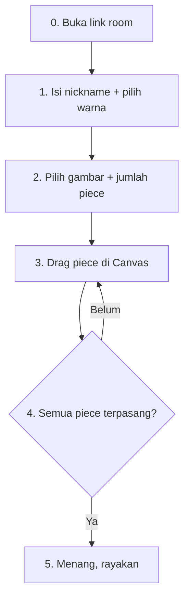

# puzzle-game

Game jigsaw puzzle multiplayer di web, buat main bareng pacar (atau bestie).
Satu board, dua orang susun piece bareng-bareng secara real-time.
Terinspirasi reel @oftwominds._ (jigsawplanet.com + Google Meet).

Status: milestone M0 belum mulai. Lihat `ROADMAP.md` buat contekan lengkap.

## Cara jalanin

```bash
cd ~/Projects/puzzle-game
npm install
npm run dev        # frontend di http://localhost:5173
```

PartyServer (multiplayer) di folder `party/`, lihat `ROADMAP.md` M2.

## Cara main



## Tech stack

| Lapisan | Pakai apa |
| --- | --- |
| Frontend | Vue 3 + Vite + TypeScript + Tailwind + Pinia |
| Board | Canvas 2D |
| Multiplayer | PartyServer + Durable Objects (Cloudflare Workers) |
| Gambar upload | Cloudflare R2 |
| Hosting | Cloudflare Pages + Workers (free tier, tanpa VPS) |

## Who does what

| Bagian | File | Tugas |
| --- | --- | --- |
| Mesin jigsaw | `app/src/game/` | Potong gambar, render, drag, snap |
| UI board | `app/src/components/BoardCanvas.vue` | Canvas + interaksi |
| Room server | `party/src/server.ts` | State piece, lock, cursor, chat |
| Protokol | `shared/` | Tipe pesan + state yang dipakai dua sisi |

## To change... | Edit...

| Mau ubah... | Edit... |
| --- | --- |
| Jumlah piece / ukuran puzzle | `app/src/game/engine.ts` |
| Warna + gaya UI | `DESIGN.md` dulu, baru komponen Vue |
| Pesan multiplayer | `shared/protocol.ts` + `party/src/server.ts` |
| Gambar preset | `app/public/images/` + `app/src/components/ImagePicker.vue` |

## Limitations to remember

- Video call tidak dibangun di sini, pakai Google Meet / WA call terpisah.
- Tanpa login: siapa pun yang punya link room bisa join.
- PartyKit hosted sudah tutup, pakai PartyServer.
- Gratis semua: jangan aktifkan add-on berbayar tanpa izin.
