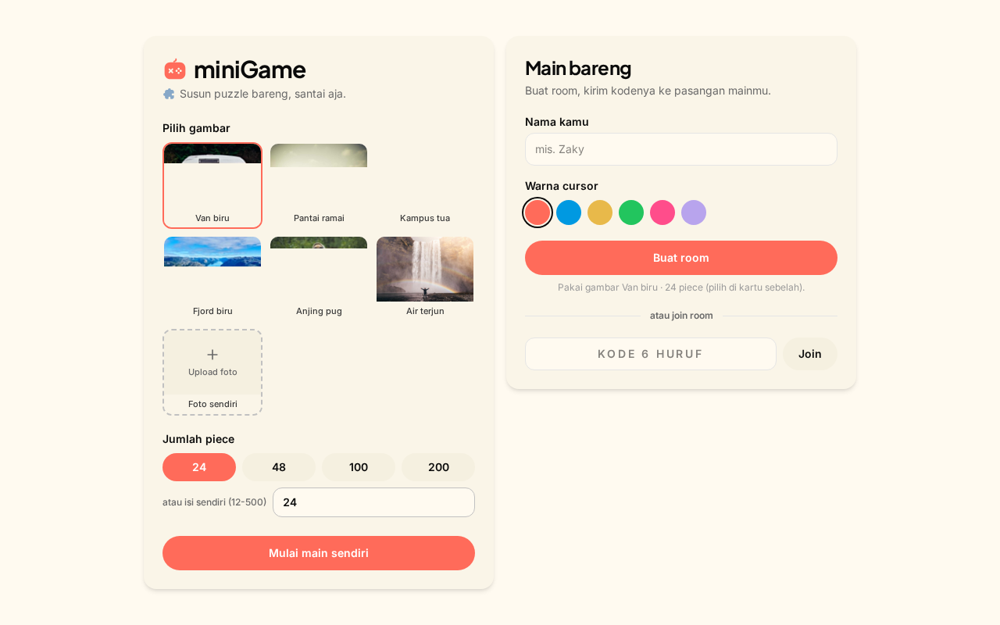
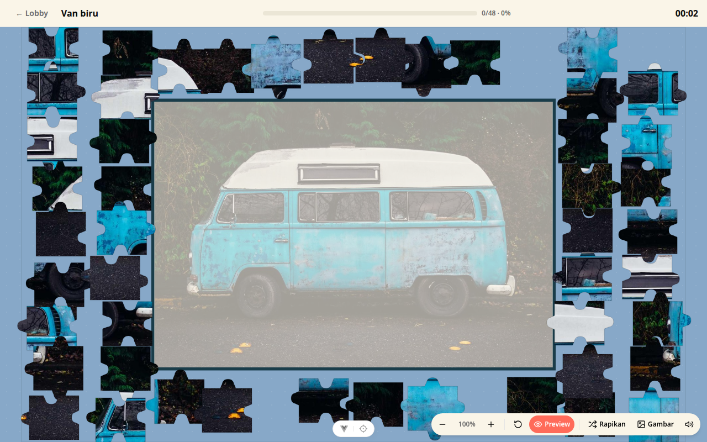

# miniGame

A tiny multiplayer mini-games platform on the web. First game:
real-time multiplayer jigsaw puzzle. One board, two people, same
puzzle. Built to play together with my girlfriend, inspired by a
reel of two friends solving a jigsaw over a video call.

**Play it:** https://minigames-bxb.pages.dev/





## How to play

1. Pick a photo (6 presets, or upload your own) and a piece count
   (24, 48, 100, 200, or any number from 12 to 500).
2. Play solo, or create a room and share the 6-letter code (or link)
   with your partner.
3. Drag pieces around the board. Pieces that fit together stick into
   a group you can move as one.
4. Drop a piece near its spot and it snaps in. Finish the whole
   picture to win.

## Features

- **Real-time multiplayer:** live cursors with names, drag locks (a
  piece your partner is holding cannot be grabbed), in-room chat,
  system messages.
- **Server-authoritative state:** piece positions live in a Durable
  Object (SQLite), so a refresh or reconnect keeps your progress.
- **Custom photos:** upload your own, compressed in the browser first
  (long side max 1600px, target under 500 KB), stored in Workers KV.
- **Custom piece counts:** any number from 12 to 500. Counts with an
  awkward grid are rounded to the nearest count with a clean grid,
  and the final count is shown.
- **Piece grouping:** correctly adjacent pieces stick together and
  move as one group. Grouping is only checked on drop, with a tight
  tolerance, so it never gives away the answer.
- **Synced timer and progress**, sort button, snap sound (mutable),
  zoom and pan, ghost preview, full-image view.
- **No login:** nickname + cursor color, join with a code or a link.

## Tech stack

| Layer | What |
| --- | --- |
| Frontend | Vue 3 (script setup) + Vite + TypeScript + Tailwind CSS v4 + Pinia |
| Board | Canvas 2D (one canvas, no DOM per piece, light on low-spec laptops) |
| Multiplayer | PartyServer on Cloudflare Workers + Durable Objects (SQLite), partysocket client |
| Uploaded images | Workers KV |
| Hosting | Cloudflare Pages + Workers, all free tier, no VPS |

## Project layout

- `app/` Vue frontend
- `party/` PartyServer worker (room state, locks, chat, image upload and serving)
- `shared/` protocol types + jigsaw engine (cutter, scatter, snap,
  grouping) used by both sides
- `docs/` screenshots, UI audit notes, CV + LinkedIn drafts
- `ROADMAP.md` milestone cheat sheet (M0-M6), `DESIGN.md` design tokens

## Run it locally

```bash
npm install
npm run dev        # frontend at http://localhost:5173
npm run party:dev  # PartyServer at http://localhost:8787
```

Note: npm 12 blocks install scripts by default. If the build fails on
esbuild or workerd, run
`npm install-scripts approve esbuild workerd && npm rebuild esbuild workerd`.

## Limitations

- No built-in video call. Use Google Meet or a WhatsApp call
  alongside, like the reel that inspired it.
- No accounts or room history. Anyone with the link can join.
- PartyKit's hosted platform shut down in October 2026. This uses
  PartyServer (self-hosted on Cloudflare Workers) instead.
- Everything runs on free tiers, no paid add-ons.
